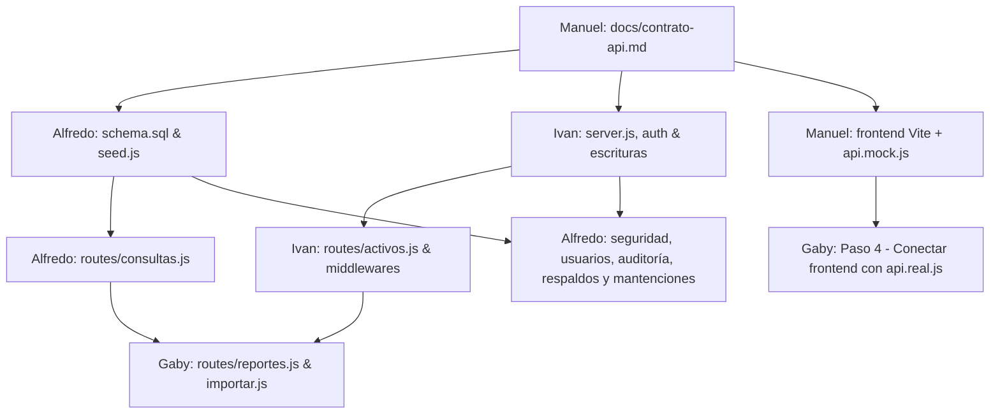

# Contrato de API REST - Sistema de Gestión de Inventario Tecnológico (Proyecto A)
**Municipalidad de San Pablo - Plan Informático Municipal 2027–2031**  
**Responsable del Contrato:** Manuel (Frontend & API Contract)  
**Versión:** 1.1.0 (seguridad, usuarios, auditoría y mantenciones)  
**Fecha:** Noviembre 2026  
**Referencia:** Sección 6.2 (Tabla 7 del Informe: *Estructura del modelo de inventario tecnológico y criterios de reserva*) y Tabla 26 (*Ficha del Proyecto A*).

---

## 1. Reglas Generales y Arquitectura de la API

1. **Host Base:** `http://localhost:3000/api` (Backend Express) / `http://localhost:5173` (Frontend Vite + React).
2. **Formato:** Todas las peticiones y respuestas utilizan `application/json; charset=utf-8` (a excepción de exportación/importación CSV con `text/csv`).
3. **Autenticación:** Vía HTTP Bearer Token en cabecera:
   ```http
   Authorization: Bearer <token_jwt>
   ```
4. **Respuestas HTTP Estándar:**
   - `200 OK`: Petición exitosa con datos de retorno.
   - `201 Created`: Recurso creado exitosamente.
   - `400 Bad Request`: Datos inválidos o faltantes en el payload.
   - `401 Unauthorized`: Token no proporcionado, expirado o inválido.
   - `403 Forbidden`: El rol del usuario no tiene permisos para esta acción o para ver este recurso.
   - `404 Not Found`: Recurso no encontrado.
   - `409 Conflict`: Conflicto de unicidad (ej. `id_activo` ya registrado) o de estado (ej. trasladar o dar de baja un activo que ya está de baja).
   - `429 Too Many Requests`: Demasiados intentos fallidos de inicio de sesión (código `TOO_MANY_REQUESTS`).
   - `500 Internal Server Error`: Error no controlado en el servidor.
5. **Estructura Estándar de Respuesta:**
   ```json
   {
     "success": true,
     "data": { ... },
     "meta": { ... }
   }
   ```
   En caso de error:
   ```json
   {
     "success": false,
     "error": {
       "code": "BAD_REQUEST",
       "message": "Descripción legible del error",
       "details": [ ... ]
     }
   }
   ```

---

## 2. Definición Exacta de Campos del Activo (Tabla 7 del Informe)

Esta tabla define el modelo canónico del activo tecnológico. Ivan y Alfredo deben usar estos nombres exactos en SQLite (`schema.sql`) y en las rutas de Express.

| Campo en API / DB | Tipo SQLite | Clasificación de Exposición | Descripción y Reglas de Negocio | Ejemplo |
| :--- | :--- | :--- | :--- | :--- |
| `id_activo` | `TEXT PRIMARY KEY` | Público / Interno | Identificador único institucional (clave primaria). Formato: `SP-HW-XXXX` o `SP-SW-XXXX`. | `"SP-HW-0042"` |
| `categoria` | `TEXT NOT NULL` | Público | Lista cerrada: `'PC'`, `'Portátil'`, `'Servidor'`, `'Red'`, `'Impresora'`, `'Software'`, `'Nube'`. | `"Portátil"` |
| `marca_modelo` | `TEXT NOT NULL` | Público | Especificación comercial general del bien o sistema. | `"Lenovo ThinkPad E14 Gen 4"` |
| `descripcion` | `TEXT` | Público | Detalle funcional o especificaciones adicionales. | `"Notebook 14\" Corporativo i5 16GB 512GB SSD"` |
| `ubicacion` | `TEXT NOT NULL` | Interno | Dependencia física/lógica donde reside el activo. | `"DIDECO - Equipo Territorial Quilacahuín"` |
| `unidad` | `TEXT NOT NULL` | Interno | Unidad municipal asignada: `'DIDECO'`, `'DOM'`, `'DAF'`, `'Secretaría Municipal'`, `'Informática'`, `'Salud'`, `'Educación'`, `'Control'`, `'SECPLAN'`, `'Alcaldía'`. | `"DIDECO"` |
| `custodio` | `TEXT NOT NULL` | Interno | Funcionario responsable del uso o resguardo directo (RUT protegido). | `"Marcela Huenchumán Soto"` |
| `estado_operativo` | `TEXT NOT NULL` | Interno | Condición verificada: `'Bueno'`, `'Regular'`, `'Malo'`, `'En reparación'`, `'De baja'`. | `"Bueno"` |
| `ultimo_mantenimiento` | `TEXT` | Interno | Fecha ISO (`YYYY-MM-DD`) de la última mantención preventiva o correctiva. | `"2026-10-15"` |
| `tipo_mantenimiento` | `TEXT` | Interno | Tipo de mantención: `'Preventiva'`, `'Correctiva'`, `'Sin mantención'`. | `"Preventiva"` |
| `criticidad` | `TEXT NOT NULL` | **Reservado** (Seguridad) | Nivel de impacto: `'Alta'`, `'Media'`, `'Baja'`. *(Oculto a `jefatura` y `lectura`)*. | `"Alta"` |
| `proceso_asociado` | `TEXT` | Interno | Proceso institucional dependiente: `'Proceso A'`, `'Proceso B'`, `'Proceso C'`, `'Proceso D'`, `'Proceso E'`. | `"Proceso A (Solicitudes)"` |
| `fecha_adquisicion` | `TEXT NOT NULL` | Público (Compras) | Fecha de compra o alta en formato ISO (`YYYY-MM-DD`). | `"2025-03-15"` |
| `fecha_garantia` | `TEXT NOT NULL` | Público (Compras) | Fecha de vencimiento de cobertura técnica (`YYYY-MM-DD`). | `"2027-03-15"` |
| `licencias_asociadas` | `TEXT` | Interno | Detalle de sistema operativo, ofimática y software instalado. | `"Windows 11 Pro OEM, Office 2021"` |
| `proveedor` | `TEXT NOT NULL` | Público (Ley 19.886)| Razón social de la empresa proveedora. | `"Proveedor TI Sur Ltda."` |
| `contrato_oc` | `TEXT NOT NULL` | Público (Ley 19.886)| ID de licitación u Orden de Compra Mercado Público. | `"OC 4521-12-SE25"` |
| `costo_inicial` | `REAL NOT NULL` | Público (Presupuesto) | Costo de adquisición inicial en pesos chilenos ($ CLP). | `650000` |
| `costo_anual` | `REAL NOT NULL` | Público (Presupuesto) | Costo recurrente anual (soporte, suscripción o mantenimiento). | `0` |
| `configuracion_red` | `TEXT` | **Estrictamente Reservado** | Direccionamiento IP, segmento VLAN, versión OS/firmware. *(Oculto a `jefatura` y `lectura`)*. | `"192.168.20.42 / VLAN 20 / Win 11 Pro 22H2"` |
| `fecha_revision` | `TEXT` | Interno | Fecha de última validación física/lógica (`YYYY-MM-DD`). | `"2026-11-10"` |
| `responsable_revision` | `TEXT` | Interno | Funcionario de TI que verificó el registro. | `"Felipe Oyarzún Mansilla"` |
| `motivo_baja` | `TEXT` | Interno | Requerido únicamente cuando `estado_operativo = 'De baja'`. | `"Obsolescencia tecnológica no reparable"` |

6. **Seguridad transversal (v1.1):**
   - Contraseñas almacenadas solo como hash **bcrypt** (`bcryptjs`, costo 10). Política: mínimo 8 caracteres, al menos una letra y un número.
   - Tokens JWT `HS256` con vigencia de 8 horas. `JWT_SECRET` obligatorio en producción (mín. 32 caracteres).
   - En cada petición se verifica que la cuenta siga **activa**: revocar un usuario invalida sus sesiones abiertas de inmediato, y los cambios de rol o unidad aplican al instante.
   - Límite de 10 intentos fallidos de login por IP cada 15 minutos (`express-rate-limit`).
   - Cabeceras HTTP de seguridad (`helmet`) y CORS restringido a los orígenes del frontend (`CORS_ORIGIN`).
   - Toda escritura, inicio de sesión, exportación, gestión de usuarios y respaldo queda en el **registro de auditoría inmutable** (Endpoint 26).
   - Detalle completo en [`docs/seguridad.md`](seguridad.md).

---

## 3. Matriz de Roles y Visibilidad de Información

El sistema contempla tres roles institucionales (conforme al Plan Informático y Ley N.º 20.285 / Ley N.º 21.663):

| Rol | Alcance de Datos | Campos Reservados (`criticidad`, `configuracion_red`) | Permisos de Escritura |
| :--- | :--- | :--- | :--- |
| **`admin_ti`** | Todos los activos de todas las unidades municipales. | **Visibles en su totalidad.** | Crear, editar, trasladar, dar de baja, importar CSV y exportar. |
| **`jefatura`** | **Solo activos de su propia unidad** (ej. si su unidad es `'DIDECO'`, el backend filtra automáticamente `WHERE unidad = 'DIDECO'`). | **Ocultos o enmascarados** (`null` o `"[RESERVADO]"`). | Solo lectura y exportación de su unidad. |
| **`lectura`** | Todos los activos del municipio (modo auditoría/transparencia). | **Ocultos o enmascarados** (`null` o `"[RESERVADO]"`). | Solo lectura y exportación. No puede crear, editar ni trasladar. |

**Permisos de seguridad y mantención (v1.1):**

| Acción | `admin_ti` | `jefatura` | `lectura` |
| :--- | :---: | :---: | :---: |
| Registrar mantención (Endpoint 20) | ✅ | ❌ | ❌ |
| Cambiar su propia contraseña (Endpoint 21) | ✅ | ✅ | ✅ |
| Gestionar usuarios y privilegios (Endpoints 22–25) | ✅ | ❌ | ❌ |
| Consultar el registro de auditoría (Endpoint 26) | ✅ | ❌ | ✅ (Control) |

### Regla para Ivan (Middleware de Roles en backend):
Si `req.user.rol !== 'admin_ti'`:
- Enmascarar los atributos `criticidad` y `configuracion_red` en **todas** las salidas, incluida la exportación CSV (solo se enmascaran si el objeto los contiene; no se agregan a respuestas que no son activos).
- Si `req.user.rol === 'jefatura'`, forzar el filtro de consulta por `unidad = req.user.unidad`.

---

## 4. Los 26 Endpoints de la API

### 4.1 Autenticación (Ivan)

#### Endpoint 1: `POST /api/auth/login`
- **Descripción:** Inicio de sesión para funcionarios autorizados.
- **Payload:**
  ```json
  {
    "username": "admin",
    "password": "password123"
  }
  ```
- **Respuesta Exitosa (200 OK):**
  ```json
  {
    "success": true,
    "data": {
      "token": "eyJhbGciOiJIUzI1NiIsInR5cCI6IkpXVCJ9.eyJpZCI6MSwidXNlcm5hbWUiOiJhZG1pbiIsInJvbCI6ImFkbWluX3RpIiwidW5pZGFkIjoiSW5mb3Jtw6F0aWNhIn0.signature",
      "user": {
        "id": 1,
        "username": "admin",
        "nombre": "Felipe Oyarzún Mansilla",
        "rol": "admin_ti",
        "unidad": "Informática"
      }
    }
  }
  ```
- **Usuarios de prueba estándar** (contraseña `password123` para los tres; se guarda solo su hash):
  1. `admin` (rol: `admin_ti`, unidad: `Informática`)
  2. `jefe_dideco` (rol: `jefatura`, unidad: `DIDECO`)
  3. `auditor` (rol: `lectura`, unidad: `Control`)
- **Errores:** `400` si falta usuario o contraseña; `401` con el mismo mensaje si el usuario no existe, la contraseña es incorrecta o la cuenta está desactivada (no revela qué usuarios existen); `429` tras 10 intentos fallidos en 15 minutos.
- Ya no existen contraseñas alternativas (`admin123`, `dideco123`, `control123`): se eliminaron del código por ser una puerta trasera.

---

### 4.2 Endpoints de Lectura (Alfredo)

#### Endpoint 2: `GET /api/activos`
- **Descripción:** Listado paginado de activos con filtros y búsqueda.
- **Parámetros Query:**
  - `q`: Búsqueda libre en `id_activo`, `marca_modelo`, `custodio`, `ubicacion`.
  - `categoria`: Filtrar por categoría (`PC`, `Portátil`, `Impresora`, etc.).
  - `estado`: Filtrar por estado operativo (`Bueno`, `Regular`, `Malo`, `En reparación`, `De baja`).
  - `unidad`: Filtrar por unidad municipal (si el usuario es `jefatura`, se sobreescribe forzosamente con su unidad).
  - `page`: Número de página (default: `1`).
  - `limit`: Cantidad por página (default: `10`, máx: `100`).
- **Respuesta Exitosa (200 OK):**
  ```json
  {
    "success": true,
    "data": [
      {
        "id_activo": "SP-HW-0042",
        "categoria": "Portátil",
        "marca_modelo": "Lenovo ThinkPad E14 Gen 4",
        "descripcion": "Notebook 14\" Corporativo i5 16GB 512GB SSD",
        "ubicacion": "DIDECO - Equipo Territorial Quilacahuín",
        "unidad": "DIDECO",
        "custodio": "Marcela Huenchumán Soto",
        "estado_operativo": "Bueno",
        "ultimo_mantenimiento": "2026-10-15",
        "tipo_mantenimiento": "Preventiva",
        "criticidad": "Alta",
        "proceso_asociado": "Proceso A (Solicitudes)",
        "fecha_adquisicion": "2025-03-15",
        "fecha_garantia": "2027-03-15",
        "licencias_asociadas": "Windows 11 Pro OEM, Office 2021",
        "proveedor": "Proveedor TI Sur Ltda.",
        "contrato_oc": "OC 4521-12-SE25",
        "costo_inicial": 650000,
        "costo_anual": 0,
        "configuracion_red": "192.168.20.42 / VLAN 20 / Win 11 Pro 22H2",
        "fecha_revision": "2026-11-10",
        "responsable_revision": "Felipe Oyarzún Mansilla",
        "motivo_baja": null
      }
    ],
    "meta": {
      "total": 106,
      "page": 1,
      "limit": 10,
      "totalPages": 11
    }
  }
  ```

#### Endpoint 3: `GET /api/activos/:id`
- **Descripción:** Ficha técnica detallada de un activo.
- **Respuesta Exitosa (200 OK):**
  ```json
  {
    "success": true,
    "data": {
      "id_activo": "SP-HW-0042",
      "categoria": "Portátil",
      "marca_modelo": "Lenovo ThinkPad E14 Gen 4",
      "descripcion": "Notebook 14\" Corporativo i5 16GB 512GB SSD",
      "ubicacion": "DIDECO - Equipo Territorial Quilacahuín",
      "unidad": "DIDECO",
      "custodio": "Marcela Huenchumán Soto",
      "estado_operativo": "Bueno",
      "ultimo_mantenimiento": "2026-10-15",
      "tipo_mantenimiento": "Preventiva",
      "criticidad": "Alta",
      "proceso_asociado": "Proceso A (Solicitudes)",
      "fecha_adquisicion": "2025-03-15",
      "fecha_garantia": "2027-03-15",
      "licencias_asociadas": "Windows 11 Pro OEM, Office 2021",
      "proveedor": "Proveedor TI Sur Ltda.",
      "contrato_oc": "OC 4521-12-SE25",
      "costo_inicial": 650000,
      "costo_anual": 0,
      "configuracion_red": "192.168.20.42 / VLAN 20 / Win 11 Pro 22H2",
      "fecha_revision": "2026-11-10",
      "responsable_revision": "Felipe Oyarzún Mansilla",
      "motivo_baja": null
    }
  }
  ```

#### Endpoint 4: `GET /api/activos/:id/historial`
- **Descripción:** Bitácora inmutable de trazabilidad y ciclo de vida del activo (Ley N.º 21.459 / Ley N.º 20.285).
- **Respuesta Exitosa (200 OK):**
  ```json
  {
    "success": true,
    "data": [
      {
        "id": 101,
        "id_activo": "SP-HW-0042",
        "fecha": "2025-03-15T09:00:00Z",
        "tipo_evento": "ALTA",
        "usuario": "Felipe Oyarzún Mansilla",
        "unidad_origen": null,
        "unidad_destino": "DIDECO",
        "custodio_anterior": null,
        "custodio_nuevo": "Marcela Huenchumán Soto",
        "motivo": "Recepción conforme OC 4521-12-SE25",
        "detalles": "Incorporación de activo nuevo según Plan Informático"
      },
      {
        "id": 145,
        "id_activo": "SP-HW-0042",
        "fecha": "2026-08-10T14:30:00Z",
        "tipo_evento": "TRASLADO",
        "usuario": "Felipe Oyarzún Mansilla",
        "unidad_origen": "DIDECO Central",
        "unidad_destino": "DIDECO - Equipo Territorial Quilacahuín",
        "custodio_anterior": "Luis Contreras",
        "custodio_nuevo": "Marcela Huenchumán Soto",
        "motivo": "Asignación para operativos en terreno sector Quilacahuín",
        "detalles": "Se entrega con cargador y bolso institucional"
      }
    ]
  }
  ```

#### Endpoint 5: `GET /api/alertas?dias=60`
- **Descripción:** Lista de garantías y licencias que vencen dentro de los próximos `dias` días (default: 60 días).
- **Respuesta Exitosa (200 OK):**
  ```json
  {
    "success": true,
    "data": {
      "garantias_por_vencer": [
        {
          "id_activo": "SP-HW-0012",
          "marca_modelo": "Dell OptiPlex 3090 Micro",
          "categoria": "PC",
          "unidad": "Oficina de Partes",
          "custodio": "Carolina Muñoz Vera",
          "fecha_garantia": "2026-12-15",
          "dias_restantes": 27,
          "proveedor": "Soluciones Austral SpA"
        }
      ],
      "licencias_por_vencer": [
        {
          "id_activo": "SP-SW-0003",
          "nombre_software": "Suscripción Antivirus Endpoint EDR",
          "unidad": "Informática",
          "fecha_vencimiento": "2026-12-31",
          "dias_restantes": 43,
          "costo_renovacion": 1200000
        }
      ]
    }
  }
  ```

#### Endpoint 6: `GET /api/catalogos`
- **Descripción:** Listas maestras para poblar los formularios y filtros del sistema.
- **Respuesta Exitosa (200 OK):**
  ```json
  {
    "success": true,
    "data": {
      "categorias": ["PC", "Portátil", "Servidor", "Red", "Impresora", "Software", "Nube"],
      "estados_operativos": ["Bueno", "Regular", "Malo", "En reparación", "De baja"],
      "unidades": [
        "Alcaldía",
        "Secretaría Municipal",
        "Control",
        "SECPLAN",
        "Juzgado de Policía Local",
        "Asesoría Jurídica",
        "DOM",
        "Aseo y Ornato",
        "DIDECO",
        "Salud",
        "Educación",
        "DAF",
        "Informática"
      ],
      "criticidades": ["Alta", "Media", "Baja"],
      "tipos_mantenimiento": ["Preventiva", "Correctiva", "Sin mantención"]
    }
  }
  ```

---

### 4.3 Endpoints de Escritura (Ivan)

#### Endpoint 7: `POST /api/activos`
- **Descripción:** Alta de un nuevo activo institucional (Solo `admin_ti`). Requiere verificar la recepción física/documental y escribe esa confirmación junto al evento `'ALTA'` inmutable.
- **Payload:**
  ```json
  {
    "id_activo": "SP-HW-0099",
    "categoria": "PC",
    "marca_modelo": "HP ProDesk 400 G7",
    "descripcion": "Intel Core i5 10ma Gen, 16GB RAM, SSD 512GB",
    "ubicacion": "Secretaría Municipal - Ventanilla Única",
    "unidad": "Secretaría Municipal",
    "custodio": "Carolina Muñoz Vera",
    "estado_operativo": "Bueno",
    "ultimo_mantenimiento": "2026-11-01",
    "tipo_mantenimiento": "Preventiva",
    "criticidad": "Alta",
    "proceso_asociado": "Proceso B (Expedientes)",
    "fecha_adquisicion": "2026-11-01",
    "fecha_garantia": "2028-11-01",
    "licencias_asociadas": "Windows 11 Pro, Office 2021 LTSC",
    "proveedor": "Tech Patagonia Ltda.",
    "contrato_oc": "OC 4521-88-SE26",
    "costo_inicial": 720000,
    "costo_anual": 0,
    "configuracion_red": "192.168.10.15 / VLAN 10 / Win 11 23H2",
    "responsable_revision": "Felipe Oyarzún Mansilla",
    "recepcion_verificada": true
  }
  ```
- `contrato_oc` y `recepcion_verificada: true` son obligatorios. La bitácora guarda el usuario, el momento y el documento asociado a la recepción.
- **Respuesta (201 Created):**
  ```json
  {
    "success": true,
    "message": "Activo creado exitosamente con registro en bitácora.",
    "data": { "id_activo": "SP-HW-0099" }
  }
  ```

#### Endpoint 8: `PUT /api/activos/:id`
- **Descripción:** Modificación de datos generales del activo (Solo `admin_ti`). Escribe evento `'EDICION'` en historial.
- **Payload:** (Campos a modificar, ej: cambio de custodio, estado o mantención)
- **Respuesta (200 OK):**
  ```json
  {
    "success": true,
    "message": "Activo actualizado exitosamente.",
    "data": { "id_activo": "SP-HW-0042" }
  }
  ```

#### Endpoint 9: `POST /api/activos/:id/traslado`
- **Descripción:** Registra el traslado físico o de responsabilidad del activo (Solo `admin_ti`). Registra `'TRASLADO'` en historial.
- **Payload:**
  ```json
  {
    "nueva_unidad": "DOM",
    "nueva_ubicacion": "Edificio Consistorial - Oficina Obras 2do piso",
    "nuevo_custodio": "Rodrigo Alarcón Fuentes",
    "motivo": "Reasignación por refuerzo de inspecciones técnicas en terreno",
    "detalles": "Activo entregado con cargador y accesorios en perfecto estado"
  }
  ```
- **Respuesta (200 OK):**
  ```json
  {
    "success": true,
    "message": "Traslado registrado exitosamente.",
    "data": {
      "id_activo": "SP-HW-0042",
      "unidad": "DOM",
      "ubicacion": "Edificio Consistorial - Oficina Obras 2do piso",
      "custodio": "Rodrigo Alarcón Fuentes"
    }
  }
  ```

#### Endpoint 10: `POST /api/activos/:id/baja`
- **Descripción:** Da de baja un activo. El `motivo` es **estrictamente obligatorio** (Solo `admin_ti`). Cambia `estado_operativo` a `'De baja'` y registra evento `'BAJA'` en historial.
- **Payload:**
  ```json
  {
    "motivo": "Falla irreversible en placa madre y costo de reparación excede el 60% del valor residual (Ley 18.695)",
    "detalles": "Informe técnico de TI N° 12-2026 adjunto en acta de descargo."
  }
  ```
- **Validación Backend:** Si `!motivo || motivo.trim() === ''`, retornar `400 Bad Request`.
- **Respuesta (200 OK):**
  ```json
  {
    "success": true,
    "message": "Activo dado de baja con causal registrada en auditoría.",
    "data": {
      "id_activo": "SP-HW-0042",
      "estado_operativo": "De baja"
    }
  }
  ```

---

### 4.4 Reportes, Importación y Exportación (Gaby)

#### Endpoint 11: `GET /api/reportes/resumen`
- **Descripción:** Consolidados para el Dashboard municipal.
- **IND-01:** Un activo cuenta como validado si tiene custodio, estado operativo, fecha de revisión y responsable de revisión informados. El porcentaje usa los activos visibles para el rol autenticado.
- **Respuesta (200 OK):**
  ```json
  {
    "success": true,
    "data": {
      "totales": {
        "total_activos": 106,
        "operativos": 101,
        "en_reparacion": 2,
        "de_baja": 3,
        "alertas_garantia": 14,
        "activos_validados": 106,
        "porcentaje_activos_validados": 100
      },
      "por_categoria": [
        { "categoria": "PC", "cantidad": 41 },
        { "categoria": "Portátil", "cantidad": 23 },
        { "categoria": "Impresora", "cantidad": 18 },
        { "categoria": "Red", "cantidad": 14 },
        { "categoria": "Software", "cantidad": 8 },
        { "categoria": "Servidor", "cantidad": 2 }
      ],
      "por_estado": [
        { "estado": "Bueno", "cantidad": 96 },
        { "estado": "Regular", "cantidad": 5 },
        { "estado": "De baja", "cantidad": 3 },
        { "estado": "En reparación", "cantidad": 2 }
      ],
      "por_unidad": [
        { "unidad": "DIDECO", "cantidad": 21 },
        { "unidad": "Informática", "cantidad": 14 },
        { "unidad": "DAF", "cantidad": 12 },
        { "unidad": "Salud", "cantidad": 12 },
        { "unidad": "DOM", "cantidad": 11 },
        { "unidad": "Educación", "cantidad": 7 },
        { "unidad": "Secretaría Municipal", "cantidad": 7 },
        { "unidad": "Alcaldía", "cantidad": 5 },
        { "unidad": "Control", "cantidad": 5 },
        { "unidad": "SECPLAN", "cantidad": 5 },
        { "unidad": "Aseo y Ornato", "cantidad": 3 },
        { "unidad": "Juzgado de Policía Local", "cantidad": 3 },
        { "unidad": "Asesoría Jurídica", "cantidad": 1 }
      ]
    }
  }
  ```

#### Endpoint 12: `GET /api/reportes/costos`
- **Descripción:** Reporte financiero de TCO por categoría y unidad.
- **Respuesta (200 OK):**
  ```json
  {
    "success": true,
    "data": {
      "inversion_total_inicial": 65080000,
      "costo_anual_recurrente_total": 4870000,
      "tco_estimado_5_anos": 89430000,
      "desglose_por_categoria": [
        { "categoria": "PC", "inversion_inicial": 24190000, "costo_anual": 0, "cantidad": 41 },
        { "categoria": "Portátil", "inversion_inicial": 15640000, "costo_anual": 0, "cantidad": 23 },
        { "categoria": "Red", "inversion_inicial": 7900000, "costo_anual": 550000, "cantidad": 14 },
        { "categoria": "Impresora", "inversion_inicial": 7150000, "costo_anual": 720000, "cantidad": 18 },
        { "categoria": "Software", "inversion_inicial": 5400000, "costo_anual": 3000000, "cantidad": 8 },
        { "categoria": "Servidor", "inversion_inicial": 4800000, "costo_anual": 600000, "cantidad": 2 }
      ],
      "desglose_por_unidad": [
        { "unidad": "Informática", "inversion_inicial": 12340000, "costo_anual": 1965000, "cantidad": 14 },
        { "unidad": "DIDECO", "inversion_inicial": 11280000, "costo_anual": 145000, "cantidad": 21 },
        { "unidad": "DOM", "inversion_inicial": 8210000, "costo_anual": 555000, "cantidad": 11 },
        { "unidad": "DAF", "inversion_inicial": 8060000, "costo_anual": 1670000, "cantidad": 12 },
        { "unidad": "Salud", "inversion_inicial": 6510000, "costo_anual": 195000, "cantidad": 12 },
        { "unidad": "Educación", "inversion_inicial": 3740000, "costo_anual": 65000, "cantidad": 7 },
        { "unidad": "Secretaría Municipal", "inversion_inicial": 3290000, "costo_anual": 40000, "cantidad": 7 },
        { "unidad": "SECPLAN", "inversion_inicial": 2900000, "costo_anual": 25000, "cantidad": 5 },
        { "unidad": "Alcaldía", "inversion_inicial": 2790000, "costo_anual": 40000, "cantidad": 5 },
        { "unidad": "Control", "inversion_inicial": 2700000, "costo_anual": 40000, "cantidad": 5 },
        { "unidad": "Aseo y Ornato", "inversion_inicial": 1290000, "costo_anual": 65000, "cantidad": 3 },
        { "unidad": "Juzgado de Policía Local", "inversion_inicial": 1290000, "costo_anual": 65000, "cantidad": 3 },
        { "unidad": "Asesoría Jurídica", "inversion_inicial": 680000, "costo_anual": 0, "cantidad": 1 }
      ]
    }
  }
  ```

#### Endpoint 13: `POST /api/importar`
- **Descripción:** Carga masiva de activos desde archivo CSV (Solo `admin_ti`).
- **Formato:** payload JSON `{ "recepcion_verificada": true, "filas": [ ... ] }`. El frontend analiza el CSV y envía las filas válidas.
- Cada fila debe incluir `contrato_oc`; el lote debe confirmar la inspección física/documental antes de registrar cualquier alta. La confirmación queda en la bitácora de cada activo.
- **Respuesta (200 OK):**
  ```json
  {
    "success": true,
    "data": {
      "resumen": {
        "total_procesadas": 15,
        "validas": 13,
        "con_error": 2
      },
      "filas_invalidas": [
        {
          "fila": 4,
          "id_activo": "SP-HW-0012",
          "error": "ID ya existe en la base de datos (clave duplicada)."
        },
        {
          "fila": 9,
          "id_activo": "SP-HW-0112",
          "error": "Categoría 'Pantalla' no permitida en lista cerrada."
        }
      ]
    }
  }
  ```

#### Endpoint 14: `GET /api/reportes/garantias?dias=90`
- **Descripción:** Garantías y licencias que vencen hoy o dentro del plazo solicitado.
- Excluye vencimientos pasados y bienes dados de baja; respeta el filtro de unidad de `jefatura`.

#### Endpoint 15: `GET /api/exportar?formato=csv|json`
- **Descripción:** Exporta activos como CSV o JSON, con campos protegidos según el rol autenticado (Ley 21.180).
- Valores permitidos para `formato`: `csv` y `json`.
- **Seguridad (v1.1):** el CSV también enmascara `criticidad` y `configuracion_red` para `jefatura` y `lectura`; las celdas que empiezan con `=`, `+`, `-` o `@` se prefijan con `'` para que Excel no ejecute fórmulas (inyección CSV). Cada exportación queda auditada.

### 4.5 Conciliación física y control de recepción

La aplicación registra la conciliación de aceptación usando una muestra aleatoria del 10% de los activos vigentes (excluye los bienes dados de baja; tamaño calculado con `ceil(total * 0.10)`). Cada elemento compara ID, ubicación, unidad, custodio y estado observados contra la ficha guardada. La tasa se calcula como `discrepancias / elementos inspeccionados * 100`; una conciliación completa cumple si el resultado es ≤5%.

Los endpoints requieren Bearer JWT. `admin_ti` puede iniciar sesiones e inspeccionar; `lectura` puede consultar resultados; `jefatura` no accede porque la muestra abarca varias unidades.

#### Endpoint 16: `GET /api/conciliaciones`
- **Descripción:** Lista sesiones de conciliación, avance, discrepancias y resultado.

#### Endpoint 17: `GET /api/conciliaciones/:id`
- **Descripción:** Devuelve la sesión y los datos registrados/observados por cada activo de la muestra.

#### Endpoint 18: `POST /api/conciliaciones`
- **Permiso:** Solo `admin_ti`.
- **Descripción:** Crea una sesión y persiste la muestra aleatoria del 10% como elementos pendientes.

#### Endpoint 19: `PUT /api/conciliaciones/:id/activos/:id_activo`
- **Permiso:** Solo `admin_ti`.
- **Payload (bien encontrado):**
  ```json
  {
    "encontrado": true,
    "id_activo_observado": "SP-HW-0042",
    "ubicacion_observado": "DIDECO - Oficina 2",
    "unidad_observado": "DIDECO",
    "custodio_observado": "Marcela Huenchumán Soto",
    "estado_operativo_observado": "Bueno"
  }
  ```
- **Payload (bien no encontrado):** `{ "encontrado": false, "detalle": "No se encontró en la ubicación informada." }`.
- Si hay discrepancias se exige `detalle`. Cada activo de la muestra se registra una sola vez; la sesión se cierra al completar toda la muestra.

### 4.6 Mantenciones (Alfredo)

#### Endpoint 20: `POST /api/activos/:id/mantenimiento`
- **Permiso:** Solo `admin_ti`.
- **Descripción:** Registra una mantención preventiva o correctiva (RF-2). Actualiza `ultimo_mantenimiento`, `tipo_mantenimiento` y, opcionalmente, `estado_operativo`, y agrega el evento `MANTENIMIENTO` a la bitácora.
- **Payload:**
  ```json
  {
    "tipo_mantenimiento": "Correctiva",
    "descripcion": "Cambio de fuente de poder",
    "fecha": "2026-11-24",
    "estado_resultante": "Bueno",
    "responsable": "Soporte TI interno",
    "costo": 45000
  }
  ```
  `tipo_mantenimiento` (`Preventiva` | `Correctiva`) y `descripcion` son obligatorios. `fecha` es opcional (por defecto hoy, no puede ser futura). `estado_resultante` admite `Bueno`, `Regular`, `Malo` o `En reparación` (para dar de baja se usa el Endpoint 10).
- **Respuesta (201 Created):**
  ```json
  {
    "success": true,
    "message": "Mantención registrada en la bitácora.",
    "data": { "id_activo": "SP-HW-0042", "tipo_mantenimiento": "Correctiva", "ultimo_mantenimiento": "2026-11-24", "estado_operativo": "Bueno" }
  }
  ```
- **Errores:** `400` datos inválidos, `404` activo inexistente, `409` activo dado de baja. Una mantención con fecha anterior a la última registrada queda en la bitácora sin retroceder `ultimo_mantenimiento`.

### 4.7 Seguridad y Accesos (Alfredo)

#### Endpoint 21: `PUT /api/auth/password`
- **Permiso:** Cualquier usuario autenticado (su propia cuenta).
- **Payload:** `{ "password_actual": "...", "password_nueva": "..." }`
- **Errores:** `401` contraseña actual incorrecta; `400` la nueva no cumple la política o es igual a la actual.

#### Endpoint 22: `GET /api/usuarios`
- **Permiso:** Solo `admin_ti`.
- **Respuesta:** lista de cuentas **sin contraseñas ni hashes**:
  ```json
  {
    "success": true,
    "data": [
      { "id": 1, "username": "admin", "nombre": "Felipe Oyarzún Mansilla", "rol": "admin_ti", "unidad": "Informática", "activo": true, "creado_en": "2026-11-24T20:00:00.000Z", "actualizado_en": "2026-11-24T20:00:00.000Z", "ultimo_acceso": "2026-11-24T20:24:00.000Z" }
    ]
  }
  ```

#### Endpoint 23: `POST /api/usuarios`
- **Permiso:** Solo `admin_ti` (aprobación de un acceso solicitado por la jefatura).
- **Payload:** `{ "username": "jefe_dom", "nombre": "Rodrigo Alarcón Fuentes", "rol": "jefatura", "unidad": "DOM", "password": "ClaveInicial2026" }`
- `username`: 3 a 30 caracteres en minúscula (letras, números, `.`, `_`, `-`). `unidad` debe existir en el catálogo.
- **Respuesta:** `201` con el usuario creado. **Errores:** `400` datos inválidos, `409` username ya existe.

#### Endpoint 24: `PUT /api/usuarios/:id`
- **Permiso:** Solo `admin_ti`.
- **Payload (todos opcionales):** `{ "nombre": "...", "rol": "lectura", "unidad": "DAF", "activo": false }`
- `activo: false` **revoca** el acceso de inmediato (incluidas las sesiones abiertas); `activo: true` lo reactiva. Las cuentas no se eliminan, para conservar la trazabilidad.
- **Errores:** `404` usuario inexistente; `409` si un `admin_ti` intenta desactivarse o quitarse el rol a sí mismo, o si el cambio dejaría al sistema sin administradores activos.

#### Endpoint 25: `PUT /api/usuarios/:id/password`
- **Permiso:** Solo `admin_ti`.
- **Descripción:** Restablece la contraseña de un usuario (contraseña temporal). **Payload:** `{ "password_nueva": "Temporal2026" }`

#### Endpoint 26: `GET /api/auditoria`
- **Permiso:** `admin_ti` y `lectura` (Control). `jefatura` recibe `403`.
- **Parámetros:** `usuario`, `accion` (prefijo, ej. `LOGIN`, `USUARIO`, `ESCRITURA`, `EXPORTACION`, `RESPALDO`), `resultado` (`OK` | `RECHAZADO` | `ERROR`), `desde` y `hasta` (`YYYY-MM-DD`), `page`, `limit` (máx. 200).
- **Respuesta:**
  ```json
  {
    "success": true,
    "data": [
      { "id": 42, "fecha": "2026-11-24T20:24:10.000Z", "usuario": "admin", "rol": "admin_ti", "ip": "127.0.0.1", "accion": "USUARIO_REVOCADO", "metodo": "PUT", "ruta": "/api/usuarios/4", "estado_http": 200, "resultado": "OK", "detalle": "username=jefe_dom; activo: 1 -> 0" }
    ],
    "meta": { "total": 1, "page": 1, "limit": 50, "totalPages": 1 }
  }
  ```
- El registro es **inmutable** (la base de datos rechaza `UPDATE` y `DELETE`) y **nunca** contiene contraseñas ni el cuerpo de las peticiones.
- Acciones registradas: `LOGIN_OK`, `LOGIN_FALLIDO`, `LOGIN_BLOQUEADO`, `ESCRITURA <MÉTODO>`, `EXPORTACION`, `USUARIO_CREADO`, `USUARIO_MODIFICADO`, `USUARIO_REVOCADO`, `USUARIO_REACTIVADO`, `USUARIO_PASSWORD_RESTABLECIDA`, `AUDITORIA_CONSULTADA`, `RESPALDO_CREADO`, `RESPALDO_ERROR`, `RESPALDO_RESTAURADO`.

---

## 5. Resumen de Asignaciones Técnicas



Cualquier discrepancia se resolverá tomando este contrato como fuente única de verdad.
