# Manual de Usuario

**Sistema de Gestión de Inventario Tecnológico (Proyecto A)**  
Ilustre Municipalidad de San Pablo — Plan Informático Municipal 2027–2031  
**Versión:** 1.1 (noviembre de 2026)  
**Responsable del manual:** Alfredo Flores Ibarra  
**Dirigido a:** funcionarios del Departamento de Informática, jefaturas de unidad y Control (auditoría interna).

> Para la instalación y la administración técnica del servidor, consulte [`manual-base-datos-y-consultas.md`](manual-base-datos-y-consultas.md) y [`seguridad.md`](seguridad.md).

---

## Índice

1. [¿Qué es el sistema?](#1-qué-es-el-sistema)
2. [Perfiles de usuario y permisos](#2-perfiles-de-usuario-y-permisos)
3. [Ingreso al sistema](#3-ingreso-al-sistema)
4. [Cómo está organizada la pantalla](#4-cómo-está-organizada-la-pantalla)
5. [Dashboard](#5-dashboard)
6. [Inventario de activos](#6-inventario-de-activos)
7. [Ficha técnica de un activo](#7-ficha-técnica-de-un-activo)
8. [Registrar un activo nuevo o editarlo](#8-registrar-un-activo-nuevo-o-editarlo)
9. [Registrar un traslado](#9-registrar-un-traslado)
10. [Registrar una mantención](#10-registrar-una-mantención)
11. [Dar de baja un activo](#11-dar-de-baja-un-activo)
12. [Reportes y métricas](#12-reportes-y-métricas)
13. [Conciliación física](#13-conciliación-física)
14. [Importar y exportar](#14-importar-y-exportar)
15. [Seguridad y accesos](#15-seguridad-y-accesos)
16. [Preguntas frecuentes y solución de problemas](#16-preguntas-frecuentes-y-solución-de-problemas)
17. [Glosario](#17-glosario)

---

## 1. ¿Qué es el sistema?

Es la plataforma web donde la Municipalidad mantiene un **inventario único y validado** de su equipamiento tecnológico: computadores, portátiles, impresoras, equipos de red, servidores y aplicaciones de software. Con el sistema usted puede:

- consultar cada activo con su ubicación, custodio, estado, garantía y costos;
- registrar todo su ciclo de vida (alta, edición, traslado, mantención y baja), que queda en una bitácora que nadie puede alterar;
- recibir alertas de garantías y licencias por vencer;
- obtener reportes para el Comité de TI y el seguimiento del Plan Informático;
- verificar físicamente el inventario mediante una conciliación por muestra;
- cargar y descargar el inventario en planillas CSV.

**Requisitos:** un navegador actualizado (Chrome, Edge o Firefox), la dirección del sistema que le entregue el Departamento de Informática y su usuario y contraseña.

---

## 2. Perfiles de usuario y permisos

Cada cuenta tiene uno de tres perfiles:

| Perfil | Pensado para | Qué activos ve |
| :--- | :--- | :--- |
| **Administrador TI** (`admin_ti`) | Departamento de Informática | Todos los de la municipalidad, con todos sus datos. |
| **Jefatura de Unidad** (`jefatura`) | Directores y jefes de unidad | **Solo los de su propia unidad**. |
| **Lectura / Control** (`lectura`) | Control, auditoría y transparencia | Todos los de la municipalidad, solo para consulta. |

Dos datos son **reservados por seguridad** (Ley N.º 21.663, Marco de Ciberseguridad): el **nivel de criticidad** y la **configuración de red** (IP, VLAN, sistema operativo, cifrado). Solo el Administrador TI puede verlos. Los demás perfiles ven el texto `[RESERVADO]` o "Nivel Reservado", incluso en las planillas exportadas.

**Qué puede hacer cada perfil:**

| Acción | Administrador TI | Jefatura | Lectura / Control |
| :--- | :---: | :---: | :---: |
| Ver dashboard, inventario, fichas y reportes | ✅ | ✅ (su unidad) | ✅ |
| Exportar el inventario a CSV | ✅ | ✅ (su unidad) | ✅ |
| Registrar, editar, trasladar, mantener o dar de baja activos | ✅ | ❌ | ❌ |
| Importar activos desde CSV | ✅ | ❌ | ❌ |
| Conciliación física: iniciar e inspeccionar | ✅ | ❌ | ❌ |
| Conciliación física: consultar resultados | ✅ | ❌ | ✅ |
| Gestionar usuarios y privilegios | ✅ | ❌ | ❌ |
| Consultar el registro de auditoría | ✅ | ❌ | ✅ |
| Cambiar su propia contraseña | ✅ | ✅ | ✅ |

Los módulos y botones que su perfil no permite **no aparecen** en el menú ni en las pantallas. Por ejemplo, una Jefatura no ve *Conciliación Física* ni *Importar / Exportar*, y en el inventario ve la etiqueta *"Alta solo Admin TI"* en lugar del botón **Nuevo Activo**.

---

## 3. Ingreso al sistema

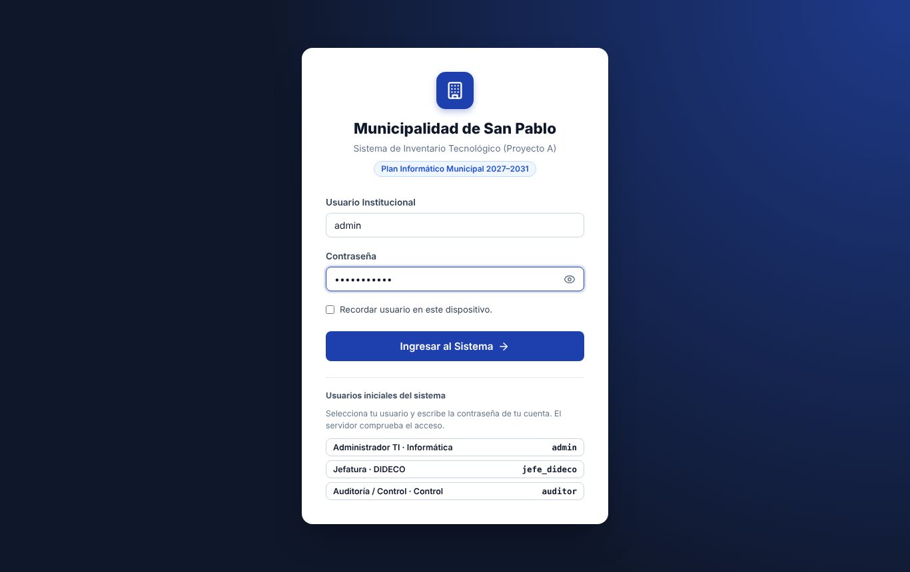

1. Abra la dirección del sistema en el navegador.
2. Escriba su **Usuario Institucional**. También puede hacer clic en su cuenta dentro de **Usuarios iniciales del sistema**, que solo completa el nombre de usuario.
3. Escriba su **Contraseña**. El ícono del ojo la muestra u oculta, para comprobar que la escribió bien.
4. Si el equipo es de uso personal, puede marcar **Recordar usuario en este dispositivo**. Solo se guarda el nombre de usuario, **nunca la contraseña**. No lo marque en computadores compartidos.
5. Presione **Ingresar al Sistema**.

Tenga en cuenta lo siguiente:

- **Credenciales incorrectas:** el sistema muestra *"Credenciales inválidas"*. Por seguridad, no indica si el error está en el usuario o en la contraseña.
- **Bloqueo por intentos:** tras **10 intentos fallidos en 15 minutos**, el ingreso desde ese equipo se bloquea durante 15 minutos. Todos los intentos quedan registrados en la auditoría.
- **Duración de la sesión:** 8 horas. Al vencer, el sistema le pedirá ingresar de nuevo.
- **Cuenta revocada:** si el Administrador TI desactiva su cuenta, su sesión se cierra en la siguiente acción que realice.
- **Cerrar sesión:** use el botón con la flecha de salida, en la esquina superior derecha. Ciérrela siempre si el computador es compartido.

> **Cuentas iniciales.** El sistema se entrega con tres cuentas iniciales (`admin`, `jefe_dideco` y `auditor`). Al instalarlo en la municipalidad, el Administrador TI debe cambiar sus contraseñas o desactivarlas y crear las cuentas reales (ver [§15](#15-seguridad-y-accesos)).

---

## 4. Cómo está organizada la pantalla

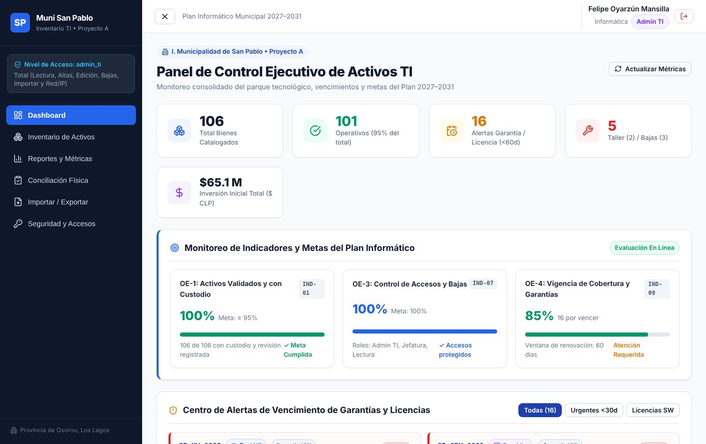

- **Menú lateral (izquierda):** acceso a cada módulo. Arriba muestra su **nivel de acceso** y qué incluye. Solo aparecen los módulos que su perfil puede usar.
- **Barra superior:**
  - a la izquierda, el botón para **ocultar o mostrar el menú lateral**, útil en pantallas pequeñas;
  - a la derecha, su nombre, su unidad y su perfil;
  - el botón para cerrar sesión.
- **Área central:** el contenido del módulo seleccionado.
- **Mensajes:** al guardar algo, aparece un aviso verde de confirmación o uno rojo con el motivo del error.

---

## 5. Dashboard

Es la pantalla inicial: un resumen del estado del parque tecnológico. Si usted es Jefatura, todas las cifras corresponden solo a su unidad.

**Indicadores superiores:**

- **Total Bienes Catalogados**
- **Operativos**: estado Bueno o Regular
- **Alertas Garantía / Licencia**: vencen en menos de 60 días
- **Taller / Bajas**
- **Inversión Inicial Total**

**Monitoreo de Indicadores y Metas del Plan Informático:** muestra el avance de los objetivos OE-1, OE-3 y OE-4 contra su meta.

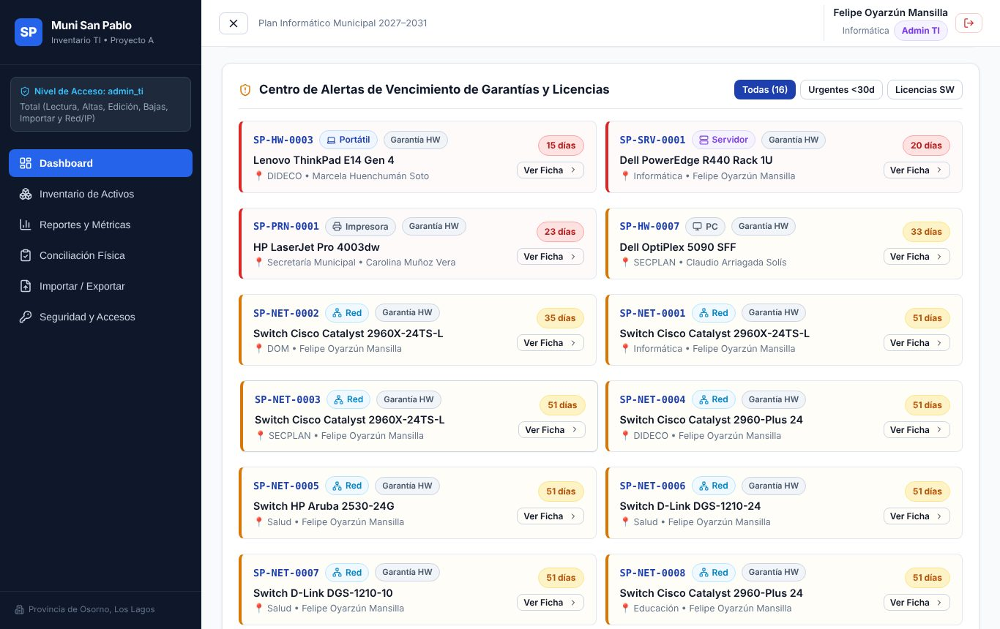

**Centro de Alertas de Vencimiento de Garantías y Licencias:** una tarjeta por cada garantía o licencia que vence en los próximos 60 días, con los **días restantes**. El color indica la urgencia: rojo si vence en menos de 30 días, naranjo en el resto.

- Los botones **Todas**, **Urgentes <30d** y **Licencias SW** filtran las tarjetas.
- **Ver Ficha** abre el activo.

**Más abajo:** gráficos de composición por categoría, salud y disponibilidad, y distribución por unidad municipal.

**Actualizar Métricas** vuelve a calcular el resumen con los datos más recientes.

---

## 6. Inventario de activos

Menú: **Inventario de Activos**.

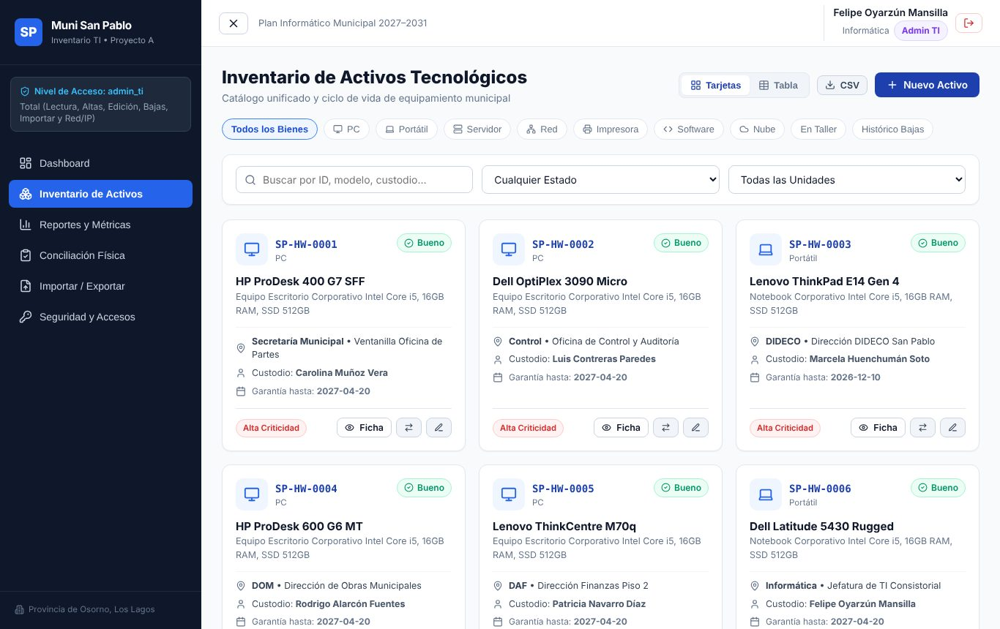

### 6.1 Vistas

- **Tarjetas:** cada activo con su código, modelo, unidad, ubicación, custodio, fecha de garantía y estado.
- **Tabla:** listado compacto con columnas, útil para revisar muchos activos.

Cambie de vista con los botones **Tarjetas** y **Tabla**, en la esquina superior derecha.

### 6.2 Buscar y filtrar

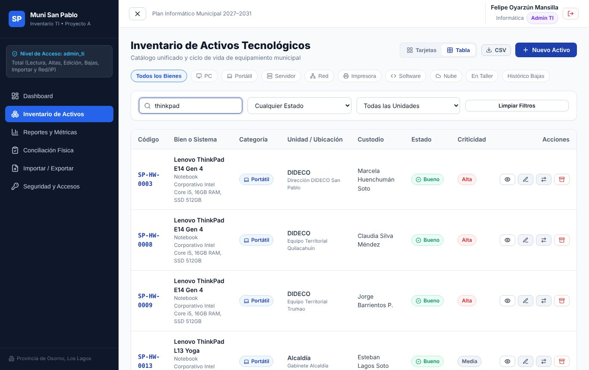

- **Botones de categoría:**
  - **Todos los Bienes**, **PC**, **Portátil**, **Servidor**, **Red**, **Impresora**, **Software** y **Nube**;
  - **En Taller**: activos en reparación;
  - **Histórico Bajas**: activos dados de baja.
- **Buscador:** escriba parte del código, el modelo o el nombre del custodio. No distingue mayúsculas de minúsculas.
- **Cualquier Estado:** filtra por estado operativo (Bueno, Regular, Malo, En reparación o De baja).
- **Todas las Unidades:** filtra por unidad municipal. Este filtro no aparece para Jefatura, que siempre ve solo su unidad.
- **Limpiar Filtros:** quita todos los filtros.

Los filtros se combinan entre sí. Si no hay resultados, el sistema lo indica y sugiere limpiar la búsqueda.

### 6.3 Acciones

- **Ficha (ojo):** abre la ficha técnica (todos los perfiles).
- **Nuevo Activo:** registra un activo nuevo (solo Administrador TI; ver [§8](#8-registrar-un-activo-nuevo-o-editarlo)).
- **CSV:** descarga en una planilla todo el inventario que su perfil puede ver (ver [§14.2](#142-exportar-el-inventario)).
- **Editar, trasladar y dar de baja:** íconos de lápiz, flechas y papelera en cada fila o tarjeta (solo Administrador TI).

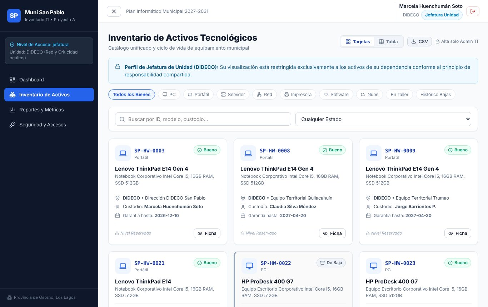

*Así ve el inventario una Jefatura: un aviso azul recuerda que solo ve los activos de su dependencia, y la criticidad aparece como "Nivel Reservado".*

---

## 7. Ficha técnica de un activo

Se abre con el botón **Ficha** o **Ver Ficha**.

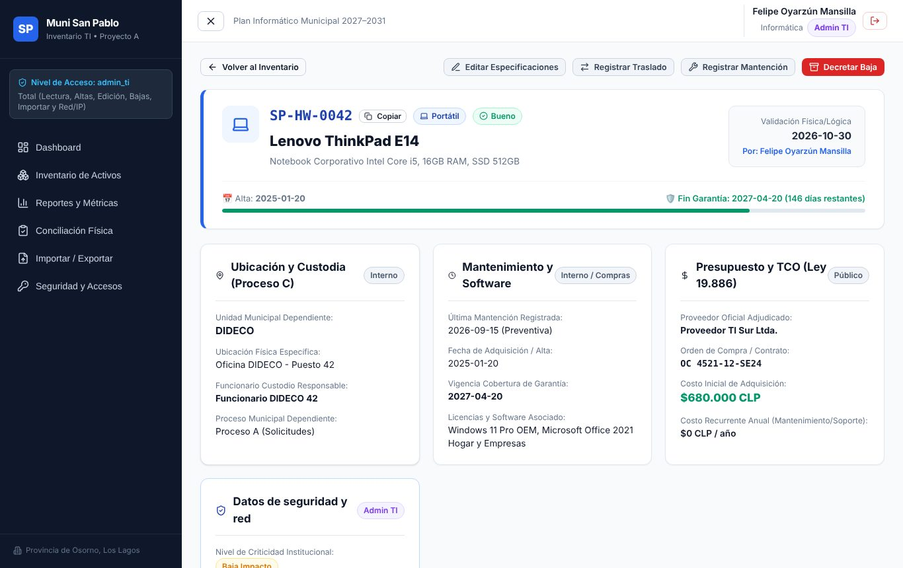

**Encabezado:**

- **Código del activo:** el botón **Copiar** lo copia al portapapeles.
- **Categoría y estado operativo.**
- **Modelo y descripción.**
- **Última validación física o lógica:** fecha y responsable.
- **Barra de vigencia de la garantía:** va desde la fecha de alta hasta el fin de la garantía, con los días restantes.

**Bloques de información:**

- **Ubicación y Custodia:** unidad, ubicación física, funcionario custodio y proceso municipal que depende del equipo.
- **Mantenimiento y Software:** última mantención y su tipo, fecha de adquisición, vigencia de la garantía y licencias asociadas.
- **Presupuesto y TCO:** proveedor, orden de compra o contrato, costo inicial y costo anual recurrente.
- **Datos de seguridad y red:** nivel de criticidad y configuración de red (Ley 21.663). **Solo visible para el Administrador TI**; los demás perfiles ven el bloque marcado como *Restringido*, con el aviso *"Información reservada"*.

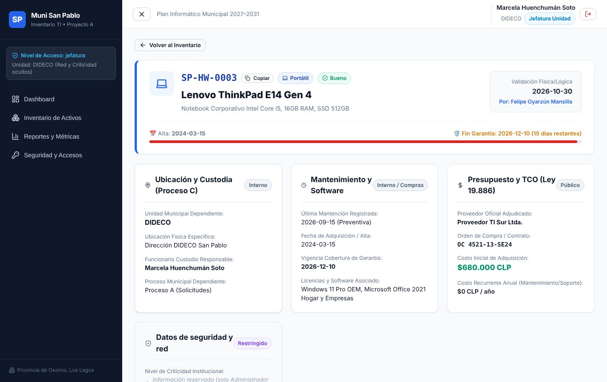

*Así ve la ficha una Jefatura: el bloque Datos de seguridad y red aparece como "Restringido".*

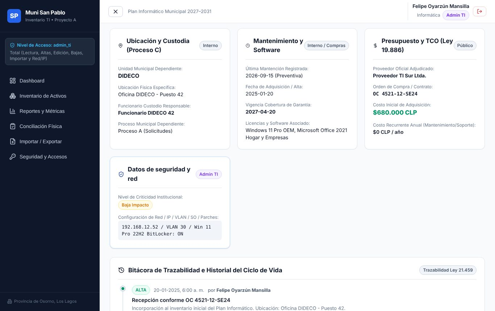

**Bitácora de Trazabilidad e Historial del Ciclo de Vida:** al final de la ficha aparecen todos los eventos del activo, del más reciente al más antiguo:

- **ALTA:** ingreso al inventario;
- **EDICION:** cambio de datos;
- **TRASLADO:** cambio de unidad, ubicación o custodio, mostrando el antes y el después;
- **MANTENIMIENTO:** mantención realizada;
- **BAJA:** retiro del inventario;
- **IMPORTACION:** ingreso por carga masiva.

Cada evento indica la fecha, quién lo registró, el motivo y los detalles. **La bitácora no se puede modificar ni borrar**, ni siquiera el Administrador TI. Así lo exige la trazabilidad del Plan y la Ley N.º 21.459.

**Botones del Administrador TI**, en la parte superior de la ficha:

- **Editar Especificaciones**
- **Registrar Traslado**
- **Registrar Mantención**
- **Decretar Baja**

Los tres últimos se ocultan si el activo ya está dado de baja.

---

## 8. Registrar un activo nuevo o editarlo

*Solo Administrador TI.* Menú **Inventario de Activos** → botón **Nuevo Activo**.

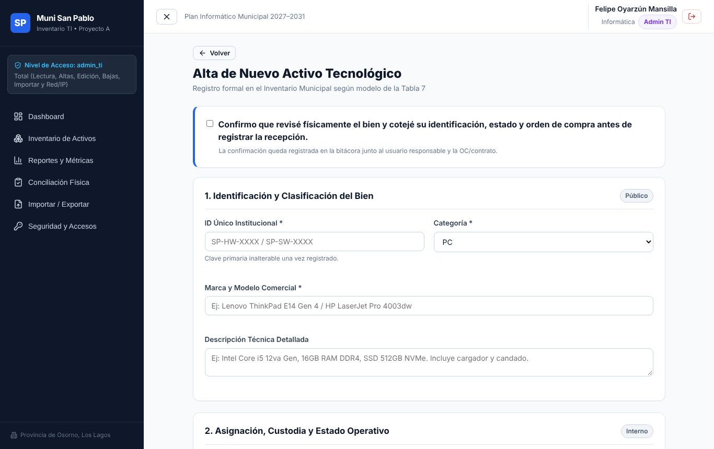

1. **Confirme la recepción.** Marque la casilla *"Confirmo que revisé físicamente el bien y cotejé su identificación, estado y orden de compra…"*. Sin esta confirmación no se puede registrar el alta, y queda anotada en la bitácora junto a su nombre y la orden de compra.
2. **Complete la sección 1, *Identificación y Clasificación*:**
   - **ID Único Institucional**, por ejemplo `SP-HW-0123` (no se puede cambiar después);
   - **Categoría**;
   - **Marca y Modelo**;
   - **Descripción técnica**, opcional.
3. **Complete la sección 2, *Asignación, Custodia y Estado*:**
   - **Unidad**;
   - **Funcionario custodio**;
   - **Ubicación física**;
   - **Estado operativo**;
   - **Proceso municipal dependiente**, opcional.
4. **Complete la sección 3, *Adquisición, Garantía y TCO (Ley 19.886)*:**
   - **Proveedor**;
   - **Orden de Compra o Contrato** (obligatoria);
   - **Fecha de adquisición** y **vencimiento de la garantía**;
   - **Costo inicial** y **costo anual recurrente** (obligatorios; escriba **0** si no aplica, por ejemplo en un equipo sin contrato de soporte o en software gratuito);
   - **Licencias asociadas**.
5. **Complete la sección 4, *Parámetros Técnicos Reservados*:**
   - **Nivel de criticidad**;
   - **Tipo de mantención**;
   - **Configuración de red** (IP, VLAN, firmware, BitLocker).
6. Presione **Completar Registro**.

Los campos marcados con `*` son obligatorios. Si falta alguno, o el ID ya existe, el sistema muestra el error y no guarda nada.

**Editar:** desde la ficha, presione **Editar Especificaciones**, modifique los datos y presione **Actualizar Activo**. El cambio queda en la bitácora como **EDICION**.

> Para cambiar la unidad o el custodio de un activo, use **Registrar Traslado** ([§9](#9-registrar-un-traslado)) en vez de editar la ficha: así queda el registro del antes y el después.

---

## 9. Registrar un traslado

*Solo Administrador TI.* En la ficha, presione **Registrar Traslado**.

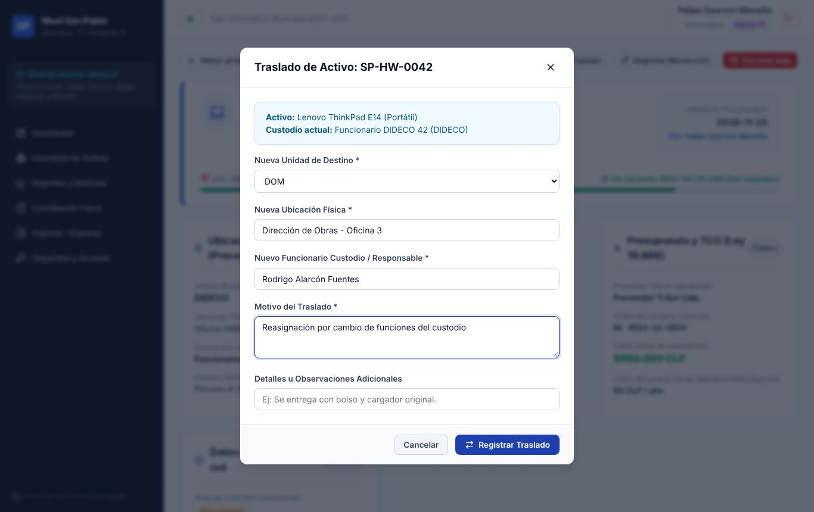

1. Revise el recuadro azul, que muestra el activo y su custodio actual.
2. Elija la **Nueva Unidad de Destino**.
3. Escriba la **Nueva Ubicación Física** y el **Nuevo Funcionario Custodio / Responsable**.
4. Escriba el **Motivo del Traslado** (obligatorio).
5. Opcionalmente, agregue **detalles**, por ejemplo: *"Se entrega con bolso y cargador"*.
6. Presione **Registrar Traslado**.

La bitácora guardará la unidad y el custodio de origen y de destino. Un activo dado de baja no se puede trasladar.

---

## 10. Registrar una mantención

*Solo Administrador TI.* En la ficha, presione **Registrar Mantención**.

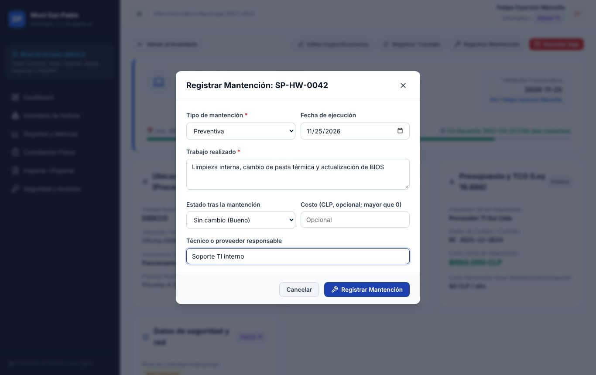

1. Elija el **Tipo de mantención**:
   - **Preventiva**: programada, como limpieza o actualizaciones;
   - **Correctiva**: reparación de una falla.
2. Indique la **Fecha de ejecución**. Por defecto es hoy y no puede ser una fecha futura.
3. Describa el **Trabajo realizado** (obligatorio).
4. Si la mantención cambió la condición del equipo, elija el **Estado tras la mantención**. Por ejemplo, de *En reparación* a *Bueno*.
5. Opcionalmente, indique el **Costo** (si lo indica, debe ser mayor que 0) y el **Técnico o proveedor responsable**.
6. Presione **Registrar Mantención**.

**Qué cambia en el sistema:**

- La ficha actualiza la *Última mantención registrada* y su tipo.
- La bitácora agrega el evento **MANTENIMIENTO**, con el detalle y el cambio de estado.
- Si registra una mantención atrasada (con fecha anterior a la última), queda en la bitácora pero no reemplaza la fecha de la última mantención.

---

## 11. Dar de baja un activo

*Solo Administrador TI.* En la ficha, presione **Decretar Baja**.

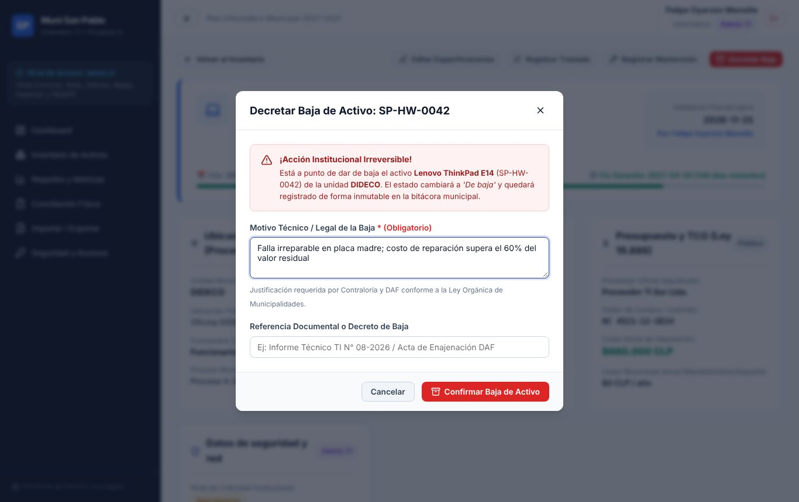

1. Lea la advertencia: **la baja es irreversible**.
2. Escriba el **Motivo Técnico / Legal de la Baja**. Es **obligatorio** según la Ley N.º 18.695 (por ejemplo: falla irreparable, pérdida u obsolescencia).
3. Opcionalmente, agregue la **Referencia Documental o Decreto de Baja**, por ejemplo: *Informe Técnico TI N.º 08-2026*.
4. Presione **Confirmar Baja de Activo**.

**Qué cambia en el sistema:**

- El activo pasa al estado **De baja** y aparece en **Histórico Bajas**.
- Deja de generar alertas de garantía y no se puede trasladar, mantener ni volver a dar de baja.
- Su historial se conserva completo: **no se borra nada**.

---

## 12. Reportes y métricas

Menú: **Reportes y Métricas**. Si usted es Jefatura, los reportes corresponden solo a su unidad.

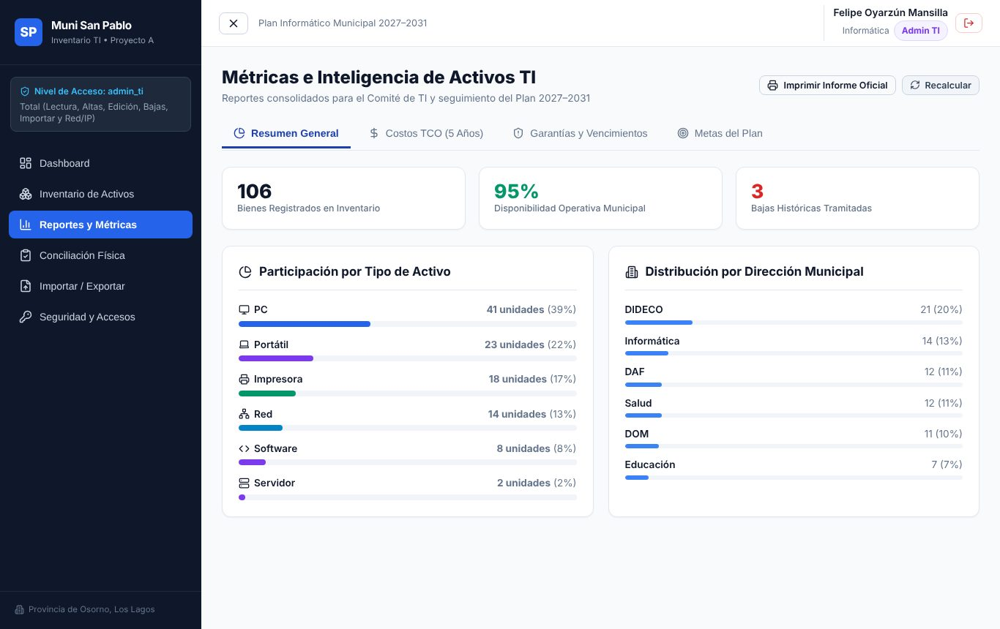

**Pestañas:**

| Pestaña | Qué muestra |
| :--- | :--- |
| **Resumen General** | Bienes registrados, disponibilidad operativa, bajas tramitadas, participación por tipo de activo y distribución por dirección municipal. |
| **Costos TCO (5 Años)** | Inversión inicial, gasto recurrente anual y costo total proyectado 2027–2031, en total y por categoría. |
| **Garantías y Vencimientos** | Garantías que vencen en los próximos 90 días, con los días restantes. |
| **Metas del Plan** | Avance de los objetivos OE-1 a OE-4 del Plan Informático contra su meta. |

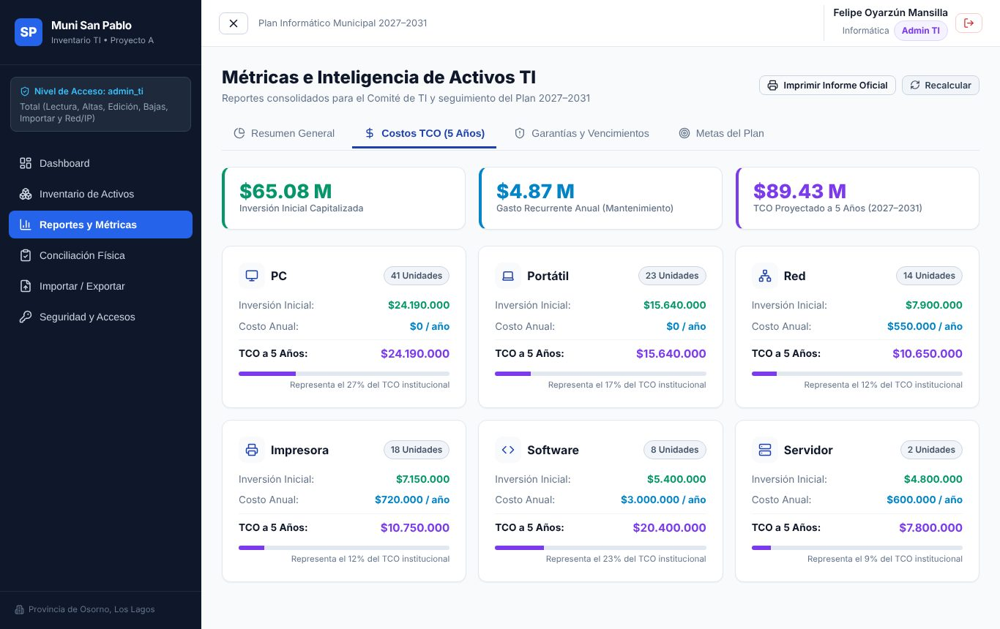

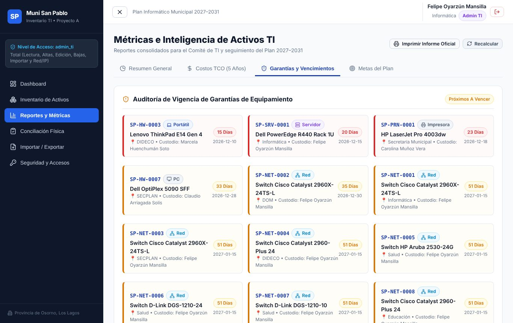

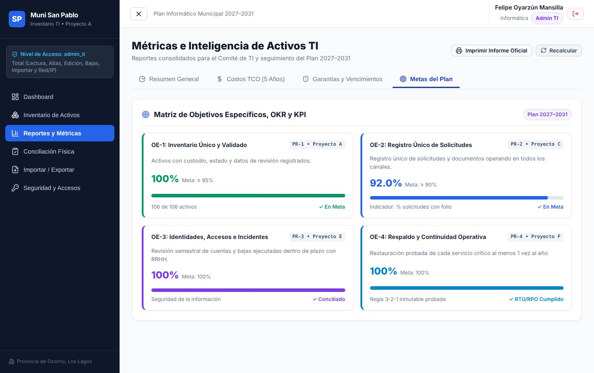

**Botones:**

- **Imprimir Informe Oficial:** abre la impresión del navegador. Elija *"Guardar como PDF"* para obtener un archivo.
- **Recalcular:** actualiza las cifras.

---

## 13. Conciliación física

Menú: **Conciliación Física**. Este módulo comprueba que el inventario registrado coincide con la realidad. Se revisa físicamente una **muestra aleatoria del 10 %** de los activos vigentes (los dados de baja no se incluyen). La conciliación **cumple** si las discrepancias son **5 % o menos**.

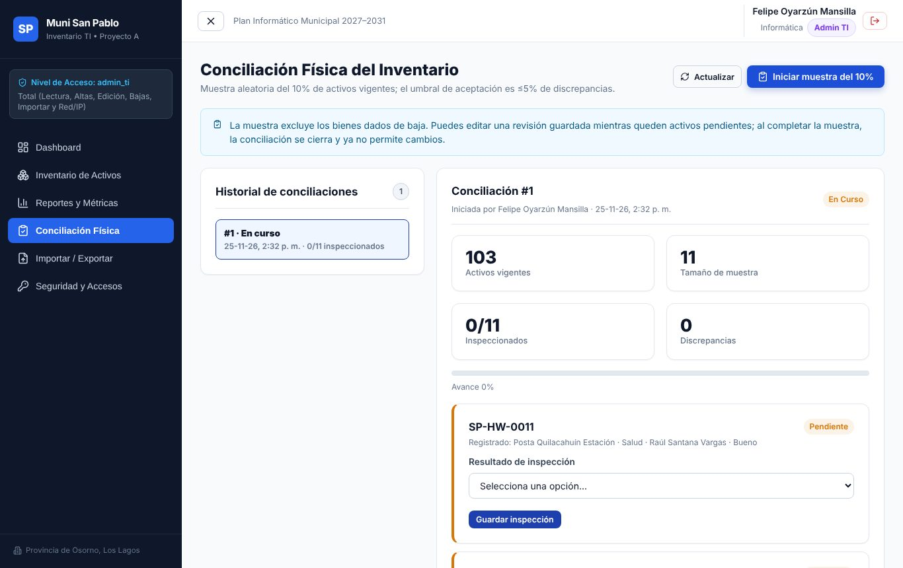

**Administrador TI: realizar una conciliación**

1. Presione **Iniciar muestra del 10%**. El sistema elige los activos al azar y muestra el avance: activos vigentes, tamaño de la muestra, inspeccionados y discrepancias. El botón **Actualizar** recarga el avance.
2. Para cada activo de la muestra, vaya a su ubicación registrada y en **Resultado de inspección** elija:
   - **Encontrado físicamente:** anote el **Estado observado**. Si algo no coincide con lo registrado (ubicación, unidad, custodio o estado), describa la diferencia en **Observación de discrepancia**, que en ese caso es obligatoria.
   - **No encontrado:** describa la situación.
3. Presione **Guardar inspección**.
4. Si se equivocó, mientras la conciliación siga **En curso** y queden activos pendientes puede presionar **Editar revisión**, corregir y presionar **Guardar cambios**.
5. Cuando inspecciona el último activo de la muestra, la conciliación se cierra sola con el resultado **Cumple** o **No cumple**. **Desde ese momento ninguna inspección se puede modificar.**

**Lectura / Control:** puede consultar el **Historial de conciliaciones** y el detalle de cada una, pero no puede iniciarlas ni inspeccionar.

> Una sola discrepancia en una muestra de 11 bienes ya supera el 5 %. Corrija en el inventario las diferencias encontradas, mediante una edición o un traslado, y repita la conciliación.

---

## 14. Importar y exportar

### 14.1 Importar activos desde una planilla CSV

*Solo Administrador TI.* Menú: **Importar / Exportar**.

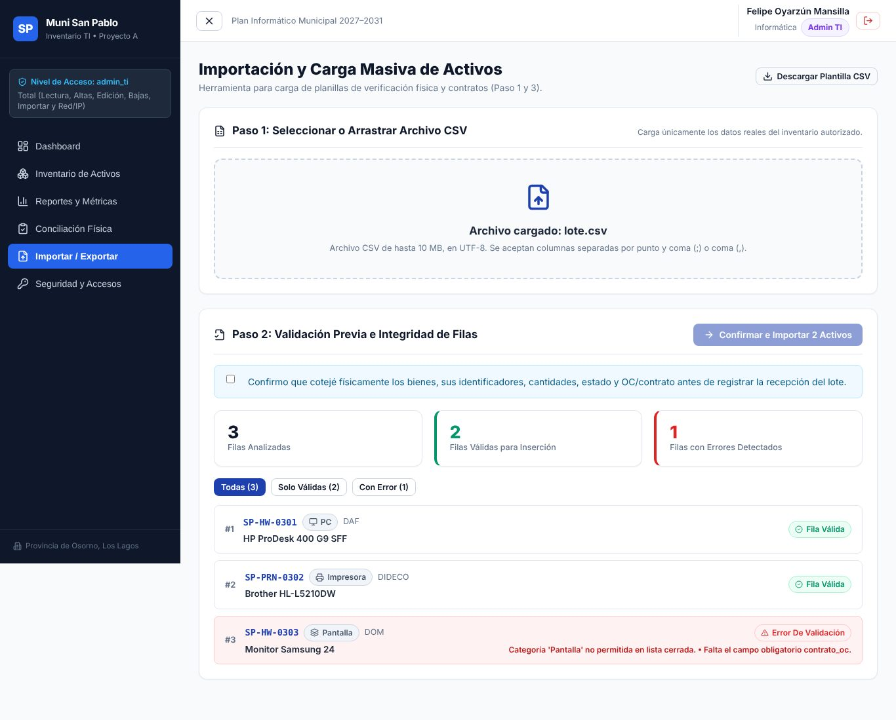

1. Presione **Descargar Plantilla CSV** para obtener la planilla con las columnas correctas:
   `id_activo, categoria, marca_modelo, descripcion, ubicacion, unidad, custodio, estado_operativo, ultimo_mantenimiento, tipo_mantenimiento, criticidad, proceso_asociado, fecha_adquisicion, fecha_garantia, licencias_asociadas, proveedor, contrato_oc, costo_inicial, costo_anual, configuracion_red`.
2. Complete la planilla en Excel o LibreOffice y guárdela como **CSV UTF-8**. Puede usar punto y coma (`;`) o coma (`,`) como separador.
   - Fechas en formato `AAAA-MM-DD`.
   - Categoría, estado, criticidad y unidad deben escribirse exactamente como en el sistema.
   - `contrato_oc`, `costo_inicial` y `costo_anual` son obligatorios. Los costos pueden ser **0** si no aplican, pero no negativos ni vacíos.
3. En **Paso 1**, arrastre el archivo al recuadro o haga clic en él para elegirlo (CSV en UTF-8, hasta 10 MB). Cargue solo datos reales del inventario autorizado.
4. En **Paso 2**, revise la **validación previa**:
   - cuántas filas se analizaron, cuántas son válidas y cuántas tienen errores;
   - las pestañas **Todas**, **Solo Válidas** y **Con Error**;
   - el motivo de cada fila con error, en rojo (por ejemplo, *"Categoría no permitida en lista cerrada"*).
5. Marque la casilla *"Confirmo que cotejé físicamente los bienes, sus identificadores, cantidades, estado y OC/contrato…"*.
6. Presione **Confirmar e Importar N Activos**. Solo se envían las filas válidas.
7. Revise el resultado. El servidor vuelve a validar cada fila y rechaza, por ejemplo, los **ID que ya existen** en el inventario, indicando la fila y el motivo.

Cada activo importado queda en su bitácora como **IMPORTACION**.

### 14.2 Exportar el inventario

En **Inventario de Activos**, presione **CSV**. Se descarga `inventario_san_pablo_<fecha>.csv` con todos los activos que su perfil puede ver:

- **Jefatura:** solo su unidad.
- **Jefatura y Lectura:** la criticidad y la configuración de red aparecen como `[RESERVADO]`.

Cada exportación queda registrada en la auditoría.

> Por seguridad, si una celda del archivo empieza con `=`, `+`, `-` o `@`, el sistema le antepone un apóstrofo (`'`). Así Excel no la ejecuta como fórmula.

---

## 15. Seguridad y accesos

Menú: **Seguridad y Accesos**. Las pestañas visibles dependen de su perfil.

### 15.1 Mi cuenta: cambiar su contraseña (todos los perfiles)

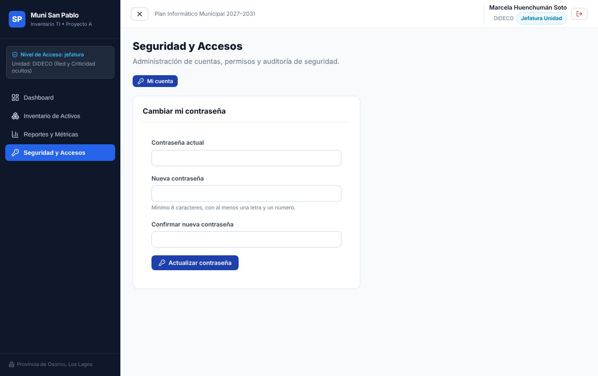

1. Escriba su **Contraseña actual**.
2. Escriba la **Nueva contraseña** y repítala en **Confirmar nueva contraseña**.
3. Presione **Actualizar contraseña**.

**Requisitos de la contraseña:** al menos **8 caracteres**, con **al menos una letra y un número**, y distinta de la actual. No la comparta ni la anote en lugares visibles. Si recibió una contraseña temporal del Administrador TI, cámbiela apenas ingrese.

### 15.2 Usuarios y privilegios (solo Administrador TI)

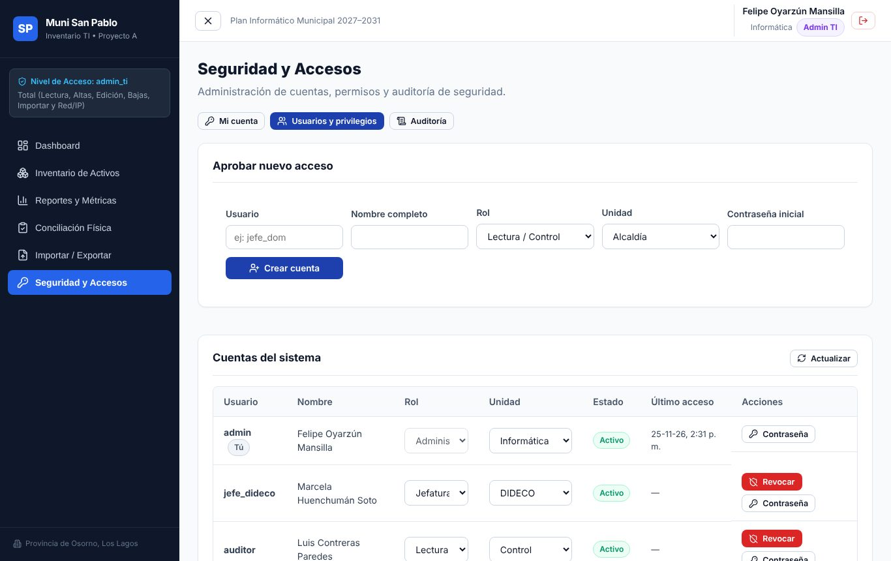

**Flujo para dar acceso a una persona:**

1. **Solicitud:** la Jefatura pide el acceso al Departamento de Informática por memo o correo institucional, indicando el funcionario, la unidad y el perfil.
2. **Aprobación:** en **Aprobar nuevo acceso**, complete:
   - el **Usuario**: minúsculas, números, punto, guion o guion bajo; por ejemplo `jefe_dom`;
   - el **Nombre completo**;
   - el **Rol**;
   - la **Unidad**;
   - una **Contraseña inicial**.

   Luego presione **Crear cuenta** y entregue la contraseña inicial al funcionario por un canal seguro.
3. **Modificación:** en **Cuentas del sistema**, cambie el **Rol** o la **Unidad** desde las listas de cada fila. El cambio se aplica de inmediato, incluso si la persona tiene una sesión abierta.
4. **Revocación:** presione **Revocar** y confirme. La cuenta queda en estado **Revocado** y sus sesiones abiertas dejan de funcionar **en ese mismo momento**. Hágalo cuando un funcionario deja la municipalidad o cambia de funciones. **Reactivar** devuelve el acceso.
5. **Contraseña olvidada:** presione **Contraseña** en la fila del usuario y escriba una contraseña temporal.

**Salvaguardas:**

- Usted no puede revocar su propia cuenta ni quitarse el rol de Administrador TI. En su fila aparece la etiqueta **"Tú"**.
- El sistema nunca queda sin un Administrador TI activo.
- Las cuentas no se eliminan, para conservar la trazabilidad de lo que hicieron.
- La lista nunca muestra contraseñas.

### 15.3 Auditoría (Administrador TI y Lectura / Control)

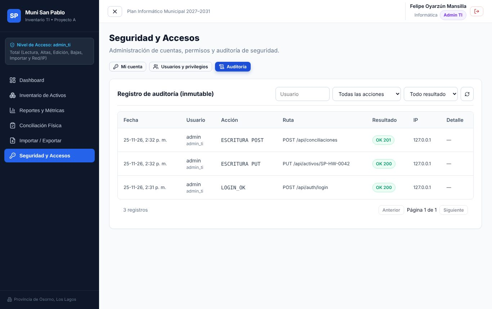

El registro de auditoría guarda, **sin posibilidad de modificarlo ni borrarlo**, quién hizo qué y cuándo. Cada fila muestra la fecha, el usuario y su perfil, la acción, la ruta, el resultado, la dirección IP y un detalle.

| Acción | Significado |
| :--- | :--- |
| `LOGIN_OK` / `LOGIN_FALLIDO` / `LOGIN_BLOQUEADO` | Ingreso exitoso, fallido (con el motivo) o bloqueado por exceso de intentos. |
| `ESCRITURA POST` / `ESCRITURA PUT` | Cualquier registro o cambio (altas, ediciones, traslados, mantenciones, bajas, importaciones, conciliaciones), incluidos los intentos rechazados por falta de permisos. |
| `EXPORTACION` | Descarga del inventario. |
| `USUARIO_CREADO` / `USUARIO_MODIFICADO` / `USUARIO_REVOCADO` / `USUARIO_REACTIVADO` / `USUARIO_PASSWORD_RESTABLECIDA` | Gestión de cuentas, con el valor anterior y el nuevo. |
| `AUDITORIA_CONSULTADA` | Alguien revisó este registro. |
| `RESPALDO_CREADO` / `RESPALDO_ERROR` / `RESPALDO_RESTAURADO` | Copias de seguridad de la base de datos. |

**Resultado:** **OK** (verde), **RECHAZADO** (amarillo: credenciales inválidas o falta de permisos) o **ERROR** (rojo: falla del sistema).

**Filtros:** use **Usuario**, el tipo de acción (inicios de sesión, escrituras, exportaciones, gestión de usuarios o respaldos) y el **resultado**. Avance con **Anterior** y **Siguiente**; se muestran 25 registros por página.

> **Recomendación para Control:** revise periódicamente los `LOGIN_FALLIDO` repetidos de un mismo usuario, los `LOGIN_BLOQUEADO`, las exportaciones fuera de horario y las revocaciones pendientes de funcionarios desvinculados.

---

## 16. Preguntas frecuentes y solución de problemas

| Situación | Qué hacer |
| :--- | :--- |
| *"Credenciales inválidas"* aunque la contraseña es correcta | Revise las mayúsculas y la tecla Bloq Mayús. Si su cuenta fue revocada, el mensaje es el mismo: consulte al Departamento de Informática. |
| *"Demasiados intentos fallidos"* | Espere 15 minutos antes de volver a intentar. |
| El sistema me devolvió a la pantalla de ingreso | La sesión venció (8 horas), su cuenta fue desactivada o el servidor se reinició. Ingrese nuevamente. |
| *"Error de conexión con el servidor"* | El servidor no responde. Informe al Departamento de Informática. |
| No veo el botón **Nuevo Activo**, **Registrar Traslado**, un módulo del menú u otro | Su perfil no tiene ese permiso (ver [§2](#2-perfiles-de-usuario-y-permisos)). |
| El formulario no me deja guardar por los costos | Los costos inicial y anual son obligatorios. Si el activo no tiene alguno de ellos, escriba **0**. |
| No encuentro un activo de otra unidad | Si usted es Jefatura, solo ve los activos de su unidad. |
| Veo `[RESERVADO]` en criticidad o red | Es lo esperado: esos datos solo los ve el Administrador TI (Ley 21.663). |
| No puedo trasladar ni registrar mantención de un activo | Si está **De baja**, ya no admite cambios. |
| Me equivoqué en una inspección de conciliación | Mientras la conciliación siga **En curso**, use **Editar revisión**. Una vez cerrada, no se puede modificar. |
| Me equivoqué en un evento de la bitácora | La bitácora no se puede corregir. Registre un nuevo evento (por ejemplo, una edición o un traslado) cuyo motivo explique la corrección. |
| La importación rechaza filas | Revise el motivo de cada fila: categoría o estado mal escrito, falta la orden de compra o un costo, o el ID ya existe. Corrija la planilla y vuelva a cargarla. |
| Olvidé mi contraseña | Solicite al Administrador TI que la restablezca y cámbiela al ingresar. |

---

## 17. Glosario

| Término | Significado |
| :--- | :--- |
| **Activo** | Bien tecnológico inventariado: equipo físico o aplicación de software. |
| **Alta** | Ingreso formal de un activo al inventario, con recepción verificada. |
| **Baja** | Retiro definitivo de un activo del inventario activo, con motivo obligatorio. |
| **Bitácora** | Historial inalterable de los eventos del ciclo de vida de un activo. |
| **Auditoría** | Registro inalterable de accesos y operaciones de los usuarios del sistema. |
| **Conciliación física** | Verificación en terreno de una muestra del inventario contra lo registrado. |
| **Criticidad** | Impacto que tendría la falla del activo en los servicios municipales (Alta, Media o Baja). Dato reservado. |
| **Custodio** | Funcionario responsable del activo. |
| **OC** | Orden de compra o contrato con que se adquirió el activo (Ley N.º 19.886). |
| **TCO** | Costo total de propiedad: inversión inicial más los costos anuales durante 5 años. |
| **Revocar** | Desactivar una cuenta. Su acceso termina de inmediato. |
| **CSV** | Formato de planilla de texto que se abre con Excel o LibreOffice. |
